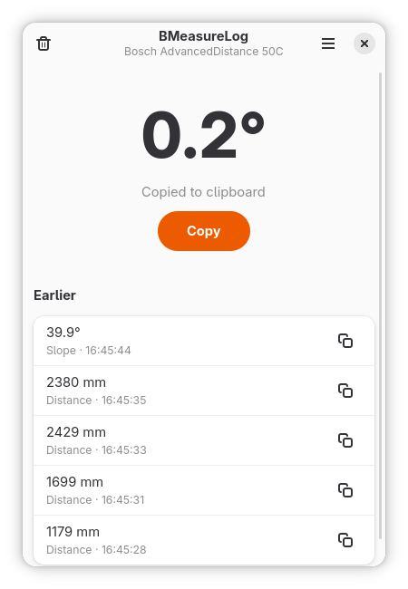

# BMeasureLog

A small GNOME app that listens to a Bluetooth laser distance meter, keeps the
last 10 readings, and copies the newest one to the clipboard.



## Why

Bluetooth laser measures such as the Bosch AdvancedDistance series send their
readings to a phone app. That is fine on a job site, but at a desk, with a CAD
program, a spreadsheet or a quote open, the number you want is on your *computer*.
BMeasureLog bridges that gap on Linux: measure with the device, paste the
result wherever your cursor is.

The protocol is not documented by the manufacturer, so it was worked out from
the outside with `bluetoothctl` and captured traffic. The project is built so that
other meters can be added by others with a modest amount of detective work;
see [Adding a new distance meter](#adding-a-new-distance-meter).

> **Unofficial.** BMeasureLog is not affiliated with or endorsed by Robert Bosch
> GmbH. Bosch and MeasureOn are trademarks of their owners. Support is based on
> observation of one device; use it at your own risk.

## Features

- Shows the latest reading large, with the last 10 kept in a list.
- **Distance** and **slope** readings.
- Copies each new reading to the clipboard automatically (or on demand).
- **Units:** distance in m, cm, mm, in, ft; slope in degrees or percent grade.
- **Rounding** to a chosen step, including 5 mm, 5 cm, 1/8 in and so on, not just
  whole decimals. Changing the unit keeps your rounding (5 mm stays 5 mm).
- Reconnects automatically if the meter goes to sleep or out of range.
- Validates every frame with the device's checksum, so corrupted data is dropped.
- Follows the [GNOME Human Interface Guidelines](https://developer.gnome.org/hig/)
  (GTK 4 and libadwaita).

## Supported meters

| Meter | Readings | Status |
|---|---|---|
| Bosch AdvancedDistance 50C (`AD 50C`) | distance, slope | Tested on one unit |

Other Bosch GLM models may share the protocol; that is untested. See
[adding a new distance meter](#adding-a-new-distance-meter) to help add yours.

## Installation

### Requirements

- Linux with BlueZ and a Bluetooth LE adapter
- GTK 4, libadwaita **1.5 or newer**, PyGObject
- Python 3.10 or newer

### Flatpak

Coming soon. Flatpak builds will be produced by GitHub Actions and attached to
releases.

### From source

**Fedora**

```bash
sudo dnf install python3-gobject gtk4 libadwaita bluez git
```

**Debian / Ubuntu (24.04 or newer)**

```bash
sudo apt install python3-gi gir1.2-gtk-4.0 gir1.2-adw-1 python3-venv bluez git
```

Then, on any distribution:

```bash
git clone https://github.com/OWNER/bmeasurelog.git   # TODO: real URL
cd bmeasurelog
python3 -m venv --system-site-packages .venv
. .venv/bin/activate
pip install -e .
bmeasurelog
```

The `--system-site-packages` flag matters: PyGObject comes from your
distribution, and without it Python reports `No module named 'gi'`.
`bleak` is installed from PyPI by `pip` (it is not packaged in every
distribution, for example not in the Fedora repositories at the time of writing).

To run without installing: `PYTHONPATH=src python3 -m bmeasurelog`.

## Usage

1. Switch on the meter and its Bluetooth.
2. **Make sure nothing else is connected to it**: close the phone app, and
   disconnect it in `bluetoothctl` if you used that. A BLE meter typically
   accepts one connection at a time and stops advertising while connected.
3. Start BMeasureLog. It finds the meter by itself; the window title shows the
   model once connected.
4. Measure. The reading appears and is copied to the clipboard.

| Shortcut | Action |
|---|---|
| `Ctrl+C` | Copy the latest reading |
| `Ctrl+,` | Preferences |
| `Ctrl+R` | Reconnect |
| `Ctrl+Backspace` | Clear history (with undo) |
| `Ctrl+Q` | Quit |

Settings are stored in `~/.config/bmeasurelog/settings.json`
(`$XDG_CONFIG_HOME` is respected).

**Clipboard note:** GNOME has no clipboard manager by default, so copied text
may be lost when BMeasureLog quits. Keep it open while you paste.

**Debugging:** run with `BMEASURELOG_DEBUG=1` to print every raw packet.

If the first connection fails, the meter may need bonding once: run `pair` and
`trust` for its address in `bluetoothctl`.

## Project layout

```
src/bmeasurelog/
  readings.py        Reading, ReadingKind: what a meter produces (base units)
  units.py           Units, conversion, rounding steps, formatting
  settings.py        Validated, persisted, observable settings (no GTK)
  meters/
    base.py          MeterProfile and Decoder: the interface a meter implements
    bosch_glm.py     Bosch AdvancedDistance 50C driver
    ble.py           Generic BLE transport (scan, connect, reconnect, notify)
    __init__.py      PROFILES: the registry of supported meters
  ui/                GTK 4 / libadwaita (the only code that imports PyGObject)
docs/protocols/      One protocol write-up per meter, plus a template
tools/crc8_search.py Finds a frame checksum's CRC-8 parameters
tests/               Unit tests (no hardware, GTK or Bluetooth needed)
```

The design keeps hardware knowledge in one small place. A meter is a
`MeterProfile` (how to recognise it, which GATT characteristic to use, what
bytes to send after connecting) plus a `Decoder` (bytes in, `Reading`s out). Both
are plain Python without I/O, so they are tested with captured frames. The BLE
transport, settings and UI know nothing about any specific meter.

Run the tests (no extra dependencies):

```bash
PYTHONPATH=src python3 -m unittest discover -s tests -v
```

## Contributing

Bug reports, pull requests and new meter support are welcome.

- Add tests for new behaviour; keep `ble.py` and `ui/` thin and put logic in
  modules that can be tested without hardware.
- New files carry `# SPDX-License-Identifier: GPL-3.0-or-later`.
- Readings are stored in base units (metres, degrees); convert only for display.

### Adding a new distance meter

You do not need to be a Bluetooth expert; you need the meter, a Linux machine
with Bluetooth, and some patience. These are the steps, using
`bluetoothctl`, that were used to work out the first supported meter.

#### 1. Prepare

- Install BlueZ tools (`bluez`). Wireshark is useful later.
- **Disconnect the meter from your phone** and close its app. Turn the meter on
  and enable its Bluetooth.

#### 2. Find and connect

```
$ bluetoothctl
[bluetooth]# power on
[bluetooth]# scan on
```

Look for a `[NEW] Device AA:BB:CC:DD:EE:FF <name>` line for your meter. Note the
**advertised name**; the driver will use it to recognise the device.

```
[bluetooth]# scan off
[bluetooth]# connect AA:BB:CC:DD:EE:FF
[bluetooth]# pair AA:BB:CC:DD:EE:FF      # only if connecting fails or asks for it
[bluetooth]# trust AA:BB:CC:DD:EE:FF
```

Once connected, the prompt shows the device name instead of `[bluetooth]`.
Pitfalls: the address needs **colons** (`AA:BB:...`, not dashes, even if the
prompt shows dashes), and a meter that is still connected to a phone will not
connect.

#### 3. List the GATT attributes

```
[AD 50C]# menu gatt
[AD 50C]# list-attributes AA:BB:CC:DD:EE:FF
```

(`list-attributes` only exists inside `menu gatt`; type `back` to return to the
main menu.) You get services, characteristics and descriptors. Ignore standard
ones (UUIDs ending in `-0000-1000-8000-00805f9b34fb`). You are looking for a
**vendor-specific service** with one or two characteristics that have a *Client
Characteristic Configuration* descriptor (`00002902-...`), meaning they send
notifications. Record the service and characteristic UUIDs.

#### 4. Read the flags

`list-attributes` does not show flags. Select each candidate characteristic by UUID and ask:

```
[AD 50C]# select-attribute <characteristic-uuid>
[AD 50C]# attribute-info
UUID: Vendor specific    (02a6c0d2-0451-4000-b000-fb3210111989)
    Flags: write-without-response
    Flags: notify
```

- `notify` / `indicate`: the meter pushes data to you.
- `write` needs a normal write; `write-without-response` needs write type `command`.
- No `read` flag means you cannot poll it; you can only listen.

Also record the firmware and hardware revision from the standard Device
Information service, which helps when firmware versions differ:

```
[AD 50C]# select-attribute 00002a26-0000-1000-8000-00805f9b34fb
[AD 50C]# read
```

(`2a26` firmware, `2a27` hardware, `2a28` software, `2a24` model number.)

#### 5. Listen

```
[AD 50C]# select-attribute <characteristic-uuid>
[AD 50C]# notify on
```

Now take measurements on the meter and watch for lines like:

```
[CHG] Attribute .../char0021 Value:
  c0 55 10 06 00 08 00 e8 d9 83 40 00 00 00 00 00  .U..............
  00 00 00 76
```

If measurements appear without writing anything, no handshake is needed. If you
only get idle or status packets, the meter probably waits for a command (step 7).

#### 6. Decode the frames

Do experiments where only one thing changes, and note frames next to what you did:

- Measure **known distances** (for example 1.000 m and 2.000 m against a tape
  measure) and compare. Look for a field that changes with the distance.
- Measure the same thing twice, and look for a **counter**.
- Interpret candidate 4-byte fields as little-endian `float32` and as
  integers (in mm or 0.1 mm). One of them will match your tape measure.
- Switch to other modes (slope, area, volume, units) and see which bytes change.
- Look for a **length** byte (it often equals the frame length minus the
  header and trailer) and a trailing **checksum**.

To identify a CRC-8 checksum, collect four or more frames of different content and run:

```bash
python3 tools/crc8_search.py "c0 55 10 06 00 08 ..." "c0 55 10 21 00 18 ..." ...
```

It prints every polynomial/init/offset that matches all frames. If nothing matches, the checksum may be a
simple sum, an XOR, or CRC-16; open an issue with your frames and we will
look together.

#### 7. Handshake (only if needed)

If the meter stays silent, it may need a command. You can try writing from `bluetoothctl`:

```
[AD 50C]# write "0xC0 0x55 0x02 0x01 0x00 0x1A" 0 command
```

(Use the type `command` for `write-without-response`, and omit it for a normal
`write`.) Be careful: unknown commands could change settings on the device. A
safer and more reliable approach is to **record what the official app does**:

1. On Android: *Developer options* → *Enable Bluetooth HCI snoop log*.
2. Toggle Bluetooth off and on, open the meter's app, connect, take
   measurements, change a unit.
3. Pull the log, for example with `adb bugreport`, and look for
   `btsnoop_hci.log` inside the zip.
4. Open it in Wireshark and filter with `btatt.handle == 0x0021` (use your
   characteristic's handle from `list-attributes`) to see exactly what the app
   writes after connecting and what comes back.

The first writes after connecting are usually the handshake.

#### 8. Document the protocol

Copy [`docs/protocols/_TEMPLATE.md`](docs/protocols/_TEMPLATE.md) to
`docs/protocols/<manufacturer>-<model>.md` and fill it in. Use
[the Bosch write-up](docs/protocols/bosch-advanced-distance-50c.md) as an
example. Say clearly what you verified and what is a guess.

#### 9. Implement the driver

Create `src/bmeasurelog/meters/<manufacturer>_<model>.py`:

```python
from typing import Sequence

from ..readings import Reading, ReadingKind
from .base import Decoder, MeterProfile


class MyDecoder(Decoder):
    def feed(self, data: bytes) -> list[Reading]:
        # Validate length and checksum; return [] for anything else.
        # Distances in metres, slopes in degrees.
        ...
        return [Reading(ReadingKind.DISTANCE, metres)]


class MyMeter(MeterProfile):
    id = "acme-laser-100"
    name = "Acme Laser 100"
    notify_uuid = "0000xxxx-..."        # characteristic that notifies
    write_uuid = None                   # None = same as notify_uuid
    write_with_response = False         # True if the flag is plain "write"

    def matches(self, local_name: str | None, service_uuids: Sequence[str]) -> bool:
        return (local_name or "").startswith("ACME")

    def handshake(self) -> list[bytes]:
        return []                       # frames to write after subscribing

    def new_decoder(self) -> Decoder:
        return MyDecoder()
```

Register it in [`meters/__init__.py`](src/bmeasurelog/meters/__init__.py):

```python
PROFILES = (BoschAdvancedDistance50C(), MyMeter())
```

If your meter reports something new (area, volume, ...), add a member to
`ReadingKind` and a matching entry in `units.py`.

#### 10. Test and open a pull request

- Add `tests/test_<meter>.py` using **real captured frames** (see
  `tests/test_bosch.py`): valid frames decode correctly, corrupt and unrelated
  packets are ignored, duplicates are dropped.
- Run the tests, then try it live with `BMEASURELOG_DEBUG=1 bmeasurelog`.
- In the pull request, tell us the exact model, firmware revision, and what you
  tested. Even a partial driver ("distance works, nothing else") is valuable.

Not sure about a step? Open an issue with your `list-attributes` output and a
few captured frames; that is usually enough for someone to help.

## License

BMeasureLog is free software, released under the
[GNU General Public License v3.0 or later](LICENSE).
